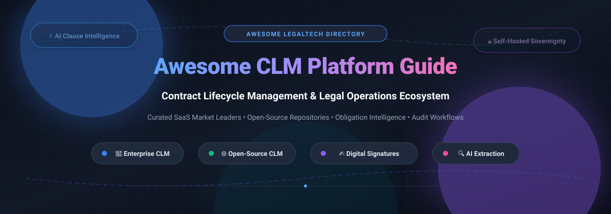

# 📜 Awesome Contract Lifecycle Management (CLM) ⚖️

  

### 🌟 Curated Directory of SaaS Platforms & Open-Source Projects for Contract Lifecycle Management (CLM) & LegalTech Operations 🚀

*Master Contract Authoring 📝, Clause Extraction 🔍, AI Redlining ⚡, Digital Signatures ✍️, Approval Workflows 🔄 & Post-Signature Obligation Tracking 🎯*

**Last updated: November 2026**

---

## 📌 Table of Contents

- [📊 Sector Overview & Market Dynamics](#-sector-overview--market-dynamics)
- [🏢 SaaS & Hosted Commercial Platforms](#-saas--hosted-commercial-platforms)
- [🌐 Open-Source GitHub Projects](#-open-source-github-projects)
- [💡 Architectural Guide: Composing a Sovereign CLM Stack](#-architectural-guide-composing-a-sovereign-clm-stack)
- [🤝 How to Contribute](#-how-to-contribute)
- [💖 Support & Sponsorship](#-support--sponsorship)
- [📈 Star History](#-star-history)
- [⚖️ Disclaimer & Legal Compliance](#️-disclaimer--legal-compliance)

---

## 📊 Sector Overview & Market Dynamics

The global **Contract Lifecycle Management (CLM)** software market is valued at approximately **$1.8B to $3.8B** and is projected to expand at a robust compound annual growth rate (**CAGR of ~12–14%**) to surpass **$8B–$11B+** within the decade, propelled by enterprise digital transformation, automated generative AI clause review, and rigorous regulatory/ESG compliance demands.

The sector exhibits **moderate fragmentation with low-to-medium vendor concentration**; the top five market leaders hold roughly 28% to 35% of total market revenue share, preventing winner-take-all capture. Market specialization remains distributed across buy-side procurement integrations (ERP-anchored), sell-side quote-to-cash workflows (CRM-anchored), and dedicated legal operations platforms prioritizing AI-driven redlining and post-signature obligation intelligence.

---

## 🏢 SaaS & Hosted Commercial Platforms

Below is a curated comparison of leading commercial CLM and document automation platforms, ordered in descending order by enterprise company scale (valuation / annual revenue).

| 🏢 Platform | 💰 Company Scale (Valuation / Revenue) | 🏷️ Starting Tier Pricing | 🎁 Free Tier / Trial Limits | 🎯 Target Audience & Trade-offs |
| :--- | :--- | :--- | :--- | :--- |
| **[HubSpot Contract Management](https://www.hubspot.com/)** | **~$12.5B–$12.8B Market Cap** (NYSE: HUBS) / ~$2.5B+ Rev | **$0/mo** (Free Core) / **$7–$10/seat/mo** (Starter billed annually) / **$90/seat/mo** (Pro) | **Free Forever Plan** (strictly capped at 2 user seats, 1 deal pipeline, 200 email tracking alerts/mo, HubSpot branding) | **Best for**: HubSpot CRM users needing native quotes and document closes. **Trade-off**: Not a standalone CLM for deep clause negotiations. |
| **[DocuSign CLM](https://www.docusign.com/)** | **~$10B–$16B Market Cap** (NASDAQ: DOCU) / ~$2.98B FY25 Rev | **$10/user/mo** (eSign Personal) / Custom quote for CLM (typically **$3,000–$8,000/mo** mid-market; **$50,000+/yr** enterprise) | **30-Day Free Trial** (full eSignature access; free document receipt and signing tier) | **Best for**: Organizations already centered on DocuSign eSignature. **Trade-off**: True CLM requires bespoke enterprise pricing and setup fees. |
| **[Icertis](https://www.icertis.com/)** | **~$5.0B Valuation** / ~$300M–$350M ARR | **Custom enterprise quote** (typically starts at **$50,000–$100,000+/yr** plus implementation) | **No Free Trial** (demo-only access through sales discovery process) | **Best for**: Global enterprises with high-volume, multi-jurisdiction contract complexity. **Trade-off**: Heavy total cost of ownership and lengthy implementation timelines. |
| **[Ironclad](https://ironcladapp.com/)** | **~$3.2B Valuation** / ~$150M–$200M ARR | **Custom quote** (entry configurations start at **$25,000–$50,000/yr**; mid-market **$50,000–$120,000+/yr**) | **14-Day Free Trial** (sandbox/pilot environment access upon demo validation) | **Best for**: In-house legal operations teams wanting AI redlining and approval chains. **Trade-off**: High annual investment and closed ecosystem. |
| **[Conga](https://conga.com/)** | **~$1.25B Valuation** (Thoma Bravo) / ~$190M–$200M+ Rev | **$35/user/mo** (base Composer module) / Custom CLM quote (median spend **$17,000–$88,000+/yr**) | **30-Day Free Trial** (available for Conga Composer in Salesforce AppExchange; CLM is demo-based) | **Best for**: Enterprises wanting CLM unified with Revenue Lifecycle & Salesforce CPQ. **Trade-off**: Complex multi-product packaging and licensing requirements. |
| **[PandaDoc](https://www.pandadoc.com/)** | **~$1.0B Valuation** (Unicorn) / ~$100M+ ARR | **$19/seat/mo** (Starter billed annually) / **$49/seat/mo** (Business billed annually) | **14-Day Free Trial** (no credit card required; full access to Business tier features) | **Best for**: Sales teams wanting quoting, document generation, and signing in one view. **Trade-off**: Lacks deep clause-level risk scoring and post-signature obligation trees. |
| **[LinkSquares](https://linksquares.com/)** | **~$800M Valuation** (Series C) / ~$50M–$60M+ ARR | **Custom quote** (modular packages starting at **~$10,000/yr** per module; scales with volume) | **No Free Trial** (evaluation requires scheduled sales demo) | **Best for**: Legal departments prioritizing contract repository AI search and analysis. **Trade-off**: Modular pricing requires purchasing Finalize, Sign, and Analyze separately. |
| **[Agiloft](https://www.agiloft.com/)** | **~$400M–$600M Est. Valuation** (KKR Majority) / ~$45M–$75M ARR | **Custom quote** (entry tiers start at **~$6,000–$7,500/yr**; enterprise median **$60,000+/yr**; Astra AI **$120/mo**) | **No Free Trial** (guided sandbox evaluation provided upon sales discovery) | **Best for**: Complex organizations requiring deep no-code workflow customization. **Trade-off**: Requires dedicated administrative configuration to maximize value. |
| **[Contractbook](https://contractbook.com/)** | **~$100M–$250M Valuation** / ~$10M+ ARR | **$399/mo** (Essential tier, billed annually) / Scales with document and user volume | **14-Day Free Trial** (no credit card required for onboarding) | **Best for**: SMBs and scale-ups seeking automated contract generation and tracking. **Trade-off**: Tier pricing steps up rapidly as document automation limits increase. |
| **[Concord](https://www.concord.app/)** | **~$50M–$100M Est. Valuation** / ~$5M–$15M Est. ARR | **$499/mo** (Essentials Plan billed annually, includes up to 5 user seats) | **14-Day Free Trial** (no credit card required; access to collaborative editing) | **Best for**: Mid-market teams wanting an intuitive collaborative negotiation interface. **Trade-off**: High initial starting monthly baseline commitment compared to per-seat tools. |

---

## 🌐 Open-Source GitHub Projects

Explore self-hostable Contract Lifecycle Management (CLM) systems, digital signing tools, document assembly frameworks, and legal AI datasets. Sorted in descending order by GitHub Stars ⭐.

- **[Paperless-ngx](https://github.com/paperless-ngx/paperless-ngx)** 
  **Supercharged document management and archiving system** (GPL-3.0) — **the premier self-hosted document repository foundation for contract storage and indexing**. **Features**: OCR document parsing, full-text search, automatic tagging, correspondent metadata, custom field matching for contract values and expiration dates, automated ingestion via email/file drops, and REST API/webhooks. **Tech stack**: Python (Django), Celery, PostgreSQL/SQLite, Redis, Angular. **Deploy**: Self-hosted (Docker Compose, bare metal). **Trade-off**: **General-purpose document management system**—requires custom workflows, tags, and custom fields to model renewal tracking and approvals; no native e-signature or multi-party redlining. **Best for**: organizations building a private, governed contract archiving repository paired with upstream drafting or signing tools.

- **[ERPNext](https://github.com/frappe/erpnext)** 
  **Full-featured enterprise resource planning with native contract management** (GPL-3.0) — **the only open-source ERP suite featuring dedicated contract lifecycle and renewal tracking out of the box**. **Features**: Native Contract DocType with start/end dates, fulfilment terms, signing parties, renewal alerts, automated invoicing linkages, document attachment, role-based approval workflows, and extensive audit logs. **Tech stack**: Python (Frappe Framework), MariaDB/PostgreSQL, Redis, JavaScript. **Deploy**: Self-hosted (Docker, Frappe bench) or Frappe Cloud. **Trade-off**: **Full ERP suite**—adopting ERPNext purely for contract management introduces broader ERP complexity; lacks deep AI redlining or native advanced e-signature without third-party integrations. **Best for**: organizations already running or adopting open-source business operations who need contract governance directly tied to procurement, billing, and accounting.

- **[DocuSeal](https://github.com/docusealco/docuseal)** 
  **Open-source document signing platform and form builder** (AGPL-3.0 with attribution) — **a modern, developer-friendly self-hosted alternative to DocuSign and PandaDoc**. **Features**: Drag-and-drop PDF field placement, multi-party signing roles, automated email reminders, mobile-optimized signing experience, PDF/e-signature verification certificates, embeddable signing widgets (React, Vue, vanilla JS), API-first automation, and webhooks. **Tech stack**: Ruby on Rails, PostgreSQL, JavaScript. **Deploy**: Self-hosted (Docker, one-click deploy) or DocuSeal Cloud. **Trade-off**: **Execution/signing layer**—focuses on standard document preparation, sending, and electronic signatures; does not handle post-signature obligation extraction or automated renewal tracking. **Best for**: developers and businesses seeking a clean, embeddable signing experience to integrate into contract workflows.

- **[Documenso](https://github.com/documenso/documenso)** 
  **Modern, community-driven open-source signing platform** (AGPL-3.0) — **the community-backed open-source alternative to DocuSign and Adobe Sign**. **Features**: Next.js-based web interface, multi-recipient workflows, custom signing fields, audit trails with cryptographic hash verification, public API, webhooks, and team management. **Tech stack**: TypeScript, Next.js, Prisma, PostgreSQL, TailwindCSS. **Deploy**: Self-hosted (Docker Compose, npm) or hosted cloud. **Trade-off**: **Signing-only platform**—no clause extraction, automated contract drafting, or post-signature obligation management. **Best for**: teams that want a modern TypeScript/Next.js stack for document signing and verification.

- **[OpenSign](https://github.com/OpenSignLabs/OpenSign)** 
  **Open-source document signing platform** (AGPL-3.0 with carve-out) — **the most recognizable self-hosted e-signature option** for CLM workflows. **Features**: **Templates with signer roles and fields**—set up once, send repeatedly; **familiar signing dashboard** for users coming from commercial tools; compose file for private deployment; tagged releases rather than a moving main branch. **Tech stack**: Node.js, React, MongoDB. **Deploy**: Self-hosted (Docker Compose file at repository root). **Trade-off**: **No renewal tracking**—e-signature only, not full CLM; slower release cadence compared to commercial tools. **Best for**: teams wanting a self-hosted DocuSign alternative with a recognizable signing workflow—paired with a contract repository for full CLM.

- **[Docassemble](https://github.com/jhpyle/docassemble)** 
  **Guided interview and document assembly platform** (MIT) — **the most mature open-source tool for guided document drafting**, widely used across legal aid and court systems. **Features**: Guided interactive questionnaires, conditional document logic, automated assembly of complex PDF and DOCX agreements, multi-language support, electronic signature capture, and integration with cloud storage. **Tech stack**: Python, YAML, PostgreSQL, Redis, Celery, Docker. **Deploy**: Self-hosted (Docker). **Trade-off**: **Drafting only**—covers pre-execution interviews and document generation; lacks obligation monitoring, renewal reminders, or enterprise approval dashboards. **Best for**: legal aid organizations and corporate legal teams needing guided, logic-driven document generation for standardized contracts, intake forms, and agreements.

- **[Mayan EDMS](https://github.com/mayan-edms/Mayan-EDMS)** 
  **Electronic document management system with metadata and workflow states** (Apache-2.0) — **a robust contract repository foundation** for teams wanting strict document governance and retention policies. **Features**: Role-based access control, cryptographic signature verification, metadata indexing, automated document retention workflows, document lifecycle tracking, and OCR capabilities. **Tech stack**: Python, Django, PostgreSQL, Celery. **Deploy**: Self-hosted (Docker). **Trade-off**: **Repository only**—renewal dates and obligation tracking must be manually configured via metadata rules; no native clause extraction or redlining tools. **Best for**: enterprise operations requiring governed, auditable document archiving with retention lifecycle controls.

- **[LibreSign](https://github.com/LibreSign/libresign)** 
  **Nextcloud native e-signature application** (AGPL-3.0) — **the most cost-effective route to self-hosted contract signing if you already run Nextcloud**. **Features**: Native Nextcloud UI integration, digital signatures with cryptographic certificates (including ICP-Brasil and standard PKI), multi-signer routing, direct storage in Nextcloud Files, and Nextcloud user permission inheritance. **Tech stack**: PHP, JavaScript (Nextcloud app framework). **Deploy**: Nextcloud App Store / Docker. **Trade-off**: **E-signature only**—no automated renewal tracking, contract redlining, or AI clause extraction. **Best for**: Nextcloud users wanting to execute contract signatures without running a separate dedicated signing server.

- **[The Atticus Project (CUAD)](https://github.com/The-Atticus-Project/cuad)** 
  **Contract Understanding Atticus Dataset & AI Review Models** (CC BY 4.0 / Apache-2.0) — **the industry-standard open legal AI benchmark and foundation for automated contract clause extraction**. **Features**: Benchmark of 510+ commercial legal contracts annotated across 41 crucial clause types (termination for convenience, indemnification, assignment, governing law, renewal notice periods, non-compete, etc.), fine-tuned transformer model weights, evaluation harness, and extraction scripts. **Tech stack**: Python, PyTorch, Hugging Face Transformers. **Deploy**: Self-hosted or integrated into custom NLP/LLM pipelines. **Trade-off**: **NLP/ML dataset and model foundation**—not an end-user UI or operational CLM system; designed to power legal AI pipelines and clause risk assessment engines. **Best for**: legaltech engineers and teams building proprietary clause extraction, contract review, and automated redlining systems.

- **[Accord Project (Template Archive & Engine)](https://github.com/accordproject/template-archive)** 
  **Open-source smart legal contract templates and execution framework** (Apache-2.0) — **the Linux Foundation standard for computable, data-driven legal agreements**. **Features**: Smart Legal Contract framework combining natural language text with machine-executable data models (Concerto) and logic (Ergo); catalog of standardized legal clauses and contract templates (NDAs, supply agreements, payment terms, SLAs); markdown-based authoring; and integration with digital ledger / API execution. **Tech stack**: JavaScript/TypeScript, WebAssembly. **Deploy**: npm packages, Docker, CLI. **Trade-off**: **Specification and templating framework**—focuses on computable contract schemas and clause drafting rather than post-signature obligation tracking or end-to-end CLM UI. **Best for**: developers and legal engineers creating standardized, machine-readable contracts and automated compliance workflows.

- **[Wraft](https://github.com/wraft/wraft)** 
  **Open-source document lifecycle management platform** (AGPL-3.0) — **a dedicated open-source solution for contract authoring, templating, and generation**. **Features**: **Markdown-based templates** with dynamic variable fields for generating contracts, NDAs, proposals, and official documents; multi-party review and approval workflows with comments; integrated electronic signatures; document version history and visual comparison; automated pipelines with webhooks; and high-fidelity PDF rendering via Pandoc, LaTeX, and Typst. **Tech stack**: Elixir (Phoenix), React, PostgreSQL, MinIO, Typesense. **Deploy**: Self-hosted (Docker Compose, Kubernetes) or hosted cloud. **Trade-off**: **Early project**—smaller contributor base and multi-service rendering pipeline. **Best for**: teams needing structured template-based contract generation, team approvals, and electronic signatures in a single self-hosted workflow.

- **[Open Contracting Data Standard (OCDS)](https://github.com/open-contracting/standard)** 
  **Global open standard for contracting data and public procurement** (Apache-2.0) — **the definitive open data schema for modeling end-to-end contracting lifecycles**. **Features**: Standardized JSON schema covering planning, tender, award, contract signing, and post-award implementation/amendments; widely adopted globally by governments and enterprise procurement systems; extensive validator tools and extensions. **Tech stack**: JSON Schema, Python documentation tooling. **Deploy**: Open standard specifications and schema validator libraries. **Trade-off**: **Data specification standard**—provides the underlying ontology and schema for contracts rather than an out-of-the-box user-facing application. **Best for**: public sector bodies, enterprise procurement teams, and developers modeling interoperable contract tracking systems.

- **[Onto-Contract](https://github.com/sharptoolbox/Onto-Contract)** 
  **Ontology-driven, AI-native contract management system** (MIT) — **an emerging AI-centric contract intelligence framework**. **Features**: Structured legal ontology mapping, AI-assisted contract information extraction, automated clause structuring, knowledge graph representation, and semantic search over contract repositories. **Tech stack**: Python, TypeScript, modern LLM orchestration. **Deploy**: Self-hosted. **Trade-off**: **Early-stage open-source project**—rapidly evolving architecture requiring technical familiarity to customize. **Best for**: legaltech teams wanting an ontology-grounded approach to structuring enterprise contracts with AI.

- **[CLAW (Command Line Law)](https://github.com/CoinCulture/claw)** 
  **Contract management for developers and legal engineers** (MIT) — **a Git-centric, CLI-driven contract workflow tool**. **Features**: Manages legal agreements as structured code using Git, Markdown, and YAML frontmatter; tracks obligations, counterparties, and payment schedules directly from the command line; diff-friendly contract version control. **Tech stack**: Python, CLI. **Deploy**: Local pip package / CLI executable. **Trade-off**: **Developer-oriented CLI**—no graphical user interface or non-technical business user onboarding. **Best for**: technical founders, developers, and legal engineers who want to manage contracts with Git workflows.

- **[draftLegal](https://github.com/AniketTati/draft-legal)** 
  **Self-hosted, AI-native contract lifecycle management** (license per repo) — **the most ambitious open-source CLM platform**, positioned as the open-source alternative to Ironclad + Harvey. **Features**: **Agent-first architecture**—a chat assistant with ~30 tools over your contracts (search, cite, compare, draft, redline, route approvals); every write proposed on a confirm card first, most undoable; **eight specialist agents** (review, draft, redline, approval summary, playbook review, assist, ask, portfolio). **Extract + cite**—clauses, dates, and values extracted, risk-scored, and cited to the clause and section; PDF citations open the original at the page. **Portfolio intelligence**—hybrid retrieval (pgvector + Elasticsearch + RRF fusion) for cross-portfolio questions about exposure, counterparties, and renewals. **Full lifecycle**—approval workflows, in-platform e-signature, and post-signature obligation tracking; **redline & negotiate** with conservative/moderate/aggressive options and exact replacement language. **Bring your own model**—Anthropic, OpenAI, or Google Gemini; no vendor lock-in. **Tech stack**: Node.js, Python, React, PostgreSQL, Elasticsearch, pgvector. **Deploy**: Self-hosted (`pnpm dev:setup` then `pnpm dev`) or hosted demo at app.draft-legal.com. **Trade-off**: **Early-stage project**—some agents (ask, portfolio) lack UI; complex setup (Docker, Node 22+, Python 3.11+). **Best for**: legal and contract operations teams wanting a self-hosted, AI-native CLM that reasons over the entire contract portfolio—with full data sovereignty and no six-figure SaaS costs.

- **[Aakd](https://github.com/aaked-app/aakd)** 
  **Open-source, self-hostable CLM for reviewed, source-linked contract operations** (AGPL-3.0) — **the most focused open-source CLM for post-signature obligation management**. **Features**: **Source-linked extraction**—upload executed PDF/DOCX, review extracted fields and obligations with **exact page-level citations**, correct anything wrong, assign owners and due dates. **Obligation and renewal views** with owners, deadlines, reminders, and audit history; **organization-scoped approvals**, comments, notifications, and activity logs. **AI is optional**—extraction, questions, and risk signals are reviewable and **never the canonical source of truth**. **Contract repository** with OCR, folders, tags, search, and version history; REST API and scoped MCP endpoint for agent-assisted, human-controlled workflows; English, French, German, Spanish, and Arabic RTL interfaces. **Tech stack**: TypeScript, PostgreSQL, Redis, MinIO. **Deploy**: Self-hosted (Docker Compose for local; production installer for Ubuntu VM). **Trade-off**: **Early release (Phase 0)**—customer validation in progress; authoring, template management, and autonomous agents are explicitly out of scope for the first release; new e-signature sends are temporarily paused. **Best for**: contract operations teams wanting to turn executed contracts into reviewed, owned actions with source-linked evidence—without autonomous AI taking over legal judgment.

- **[Marai](https://github.com/ProgrammingNotJustCoding/marai)** 
  **Open-source legal workflow and contract lifecycle management system** (MIT) — **a dedicated community project exploring full-stack legal operations and contract tracking**. **Features**: Contract drafting assistance, review pipelines, stage-based lifecycle tracking, approval delegation, and document storage. **Tech stack**: TypeScript, Node.js, React. **Deploy**: Self-hosted (Docker / local setup). **Trade-off**: **Active rewrite / prototype stage**—ongoing refactoring across branches. **Best for**: developers wanting to contribute to or experiment with an open-source legal workflow prototype.

- **[OpenCLM](https://github.com/bytecrunch-io/openclm)** 
  **Modern, self-hostable contract lifecycle management platform** (Apache-2.0 / MIT) — **an emerging open-source CLM built for collaborative redlining and digital execution**. **Features**: In-browser collaborative contract drafting and redlining, multi-stage approval workflows, integrated electronic signatures, cryptographic sealed PDF generation, and an API-first architecture designed for business application integration. **Tech stack**: TypeScript, Next.js, Node.js. **Deploy**: Self-hosted (Docker Compose). **Trade-off**: **Early stage release**—rapidly expanding feature set and community footprint. **Best for**: teams seeking an end-to-end self-hostable CLM with built-in drafting, redlining, and digital signing.

- **[Shillinq](https://github.com/ConductionNL/shillinq)** 
  **Open-source business administration suite with contract lifecycle management** (EUPL-1.2) — **a modular European public administration & enterprise suite for contracts, procurement, and invoicing**. **Features**: Contract lifecycle tracking, vendor relationship records, procurement tie-ins, obligation dates, Nextcloud integration, and auditable accounting logs. **Tech stack**: PHP (Symfony/Nextcloud ecosystem), Docker. **Deploy**: Self-hosted (Docker). **Trade-off**: **Suite module**—contract management exists as a module within a broader enterprise bookkeeping and procurement suite rather than a specialized standalone CLM. **Best for**: European organizations, public sector entities, or Nextcloud users needing contract records alongside invoicing and vendor management.

---

## 💡 Architectural Guide: Composing a Sovereign CLM Stack

Building an in-house or privacy-first legal operations infrastructure? You can assemble a best-of-breed open-source stack using modular components:

- **Full Lifecycle & Redlining**: Deploy **[draftLegal](https://github.com/AniketTati/draft-legal)** or **[OpenCLM](https://github.com/bytecrunch-io/openclm)** for interactive browser-based review and multi-agent AI redlining.
- **Post-Signature Obligation Intelligence**: Integrate **[Aakd](https://github.com/aaked-app/aakd)** to track milestones, renewal notices, and obligations tied to page-level citations.
- **Contract Authoring & Templating**: Use **[Wraft](https://github.com/wraft/wraft)** for Markdown/LaTeX dynamic document generation or **[Docassemble](https://github.com/jhpyle/docassemble)** for conditional client intake interviews.
- **Standardized Machine Logic**: Implement **[Accord Project](https://github.com/accordproject/template-archive)** to bind computable clauses to legal agreements.
- **Self-Hosted E-Signatures**: Route final PDFs to **[DocuSeal](https://github.com/docusealco/docuseal)** or **[Documenso](https://github.com/documenso/documenso)** for audit-trailed cryptographic signing.
- **Governed Archival Repository**: Store and OCR-index final agreements within **[Paperless-ngx](https://github.com/paperless-ngx/paperless-ngx)** or **[Mayan EDMS](https://github.com/mayan-edms/Mayan-EDMS)**.
- **Proprietary AI Clause Extraction**: Fine-tune transformer models using **[The Atticus Project (CUAD)](https://github.com/The-Atticus-Project/cuad)** to extract and audit risk clauses across portfolios.

---

## 🤝 How to Contribute

Contributions from legaltech practitioners, software engineers, and contract managers are warmly welcomed! 🌟

1. **Fork the repository** 🍴
2. **Add or refine entries** in `README.md` following our standard tabular or listing conventions.
3. **Include factual metadata**: Vendor/project name, official documentation/repo link, verified pricing or open-source license, and primary architectural tradeoffs.
4. **Submit a Pull Request** 🚀 with a brief description of the addition.

---

## 💖 Support & Sponsorship

If this curated CLM resource saved your team research time or helped guide your legal operations architecture, please consider supporting the project! ☕

- ⭐ **Star this repository** to improve visibility across GitHub.
- 🍴 **Fork and share** it with your legal engineering and contract operations peers.
- ☕ **Buy a coffee & sponsor**: Support ongoing research and maintenance via our [Sponsor Dashboard](https://github.com/sponsors/ishandutta2007).

---

##  Star History

---

## ⚖️ Disclaimer & Legal Compliance

- This repository is a **community-curated research directory** — not legal advice and not a formal vendor endorsement.
- CLM platforms managing commercial agreements, employment files, and nondisclosure terms handle sensitive personally identifiable information (PII) and privileged intellectual property. Implementations must comply with strict data protection regulations (**GDPR, CCPA, HIPAA, SOC 2 Type II**).
- **The "Full CLM" vs. "Signing Layer" distinction**: Tools like DocuSeal, Documenso, and OpenSign provide e-signatures; they do not extract clauses or manage post-signature obligations natively. Pair signing tools with contract repositories or full CLM suites for end-to-end lifecycle governance.
- **Enterprise Pricing Notice**: Commercial CLM pricing varies based on seat tier, active contract volume, add-on AI compute, and mandatory onboarding fees. Always confirm final software terms directly with vendor sales representatives.

---

**Built with ❤️ for Legal Operations Teams, Contract Managers, and Open-Source Advocates.**

